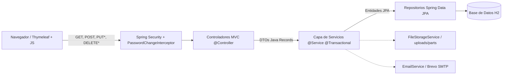
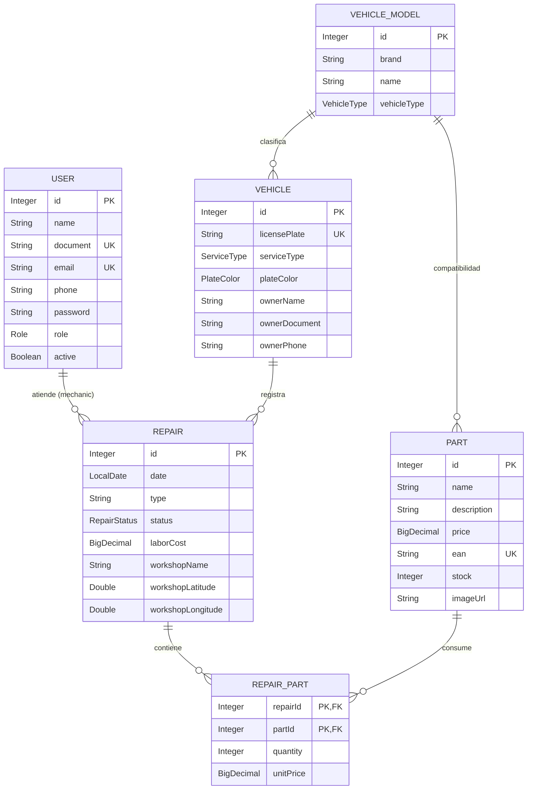

# Veloxa Service — Sistema de Gestión de Taller Automotriz


**Veloxa Service** es una aplicación web monolítica desarrollada con **Spring Boot** y **Thymeleaf** bajo una arquitectura MVC por capas y un sistema de diseño propio (**Neo-Garage OS**). Permite gestionar integralmente las operaciones de un taller automotriz: control de acceso por roles, catálogo de modelos, registro de vehículos con validación normativa de placas colombianas, inventario de repuestos con fotografías de referencia, órdenes de reparación transaccionales y geolocalización interactiva de talleres y puntos de compra.

---

## Tabla de Contenidos

1. [Características y Requisitos Funcionales](#1-características-y-requisitos-funcionales)
2. [Arquitectura del Sistema](#2-arquitectura-del-sistema)
3. [Stack Tecnológico](#3-stack-tecnológico)
4. [Seguridad y Control de Acceso (RBAC)](#4-seguridad-y-control-de-acceso-rbac)
5. [Reglas de Negocio Destacadas](#5-reglas-de-negocio-destacadas)
6. [Estructura del Proyecto](#6-estructura-del-proyecto)
7. [Requisitos Previos e Instalación](#7-requisitos-previos-e-instalación)
8. [Configuración y Variables de Entorno](#8-configuración-y-variables-de-entorno)
9. [Mapa de Rutas MVC](#9-mapa-de-rutas-mvc)
10. [Consola H2 y Usuarios de Prueba](#10-consola-h2-y-usuarios-de-prueba)
11. [Proyección a Producción (Arquitectura To-Be)](#11-proyección-a-producción-arquitectura-to-be)
12. [Autores](#12-autores)

---

## 1. Características y Requisitos Funcionales

### Seguridad y Gestión de Personal (`RF-01` a `RF-07`)
* **Autenticación Segura (`RF-01`, `RF-02`):** Inicio de sesión con correo electrónico (`email`) y contraseña cifrada con **BCrypt**, y cierre de sesión protegido vía `POST /logout` con token **CSRF**.
* **Recuperación y Cambio de Contraseña (`RF-03`, `RF-04`):** Solicitud de restablecimiento con respuesta neutra (anti-enumeración de correos), envío de enlace temporal con vigencia de 30 minutos mediante **Brevo SMTP**, y cambio obligatorio de contraseña temporal en el primer ingreso mediante `PasswordChangeInterceptor`.
* **Control de Roles (`RF-05`):** Restricción estricta de rutas y métodos HTTP para `ADMIN` y `MECHANIC`, con página personalizada de acceso denegado (`HTTP 403`).
* **Administración de Usuarios (`RF-06`, `RF-07`):** Alta de personal con generación de contraseña temporal de visualización única (*Flash Attribute*), edición con inmutabilidad de correo y documento, desactivación de cuentas para preservar trazabilidad y bloqueo de borrado si existen reparaciones asociadas.

### Modelos y Flota Vehicular (`RF-08` a `RF-15`, `RF-27`)
* **Catálogo de Modelos (`RF-08` a `RF-11`):** Registro y consulta de marcas, líneas y tipos de vehículo (`VehicleType`), determinando automáticamente el formato de placa correspondiente.
* **Registro y Control de Vehículos (`RF-12` a `RF-15`):** Normalización automática de placas, validación normativa colombiana según tipo y servicio, cálculo automático del color de placa con vista previa en vivo (`vehicles.js`), validación internacional de celulares y filtros de búsqueda por placa y propietario.
* **Consulta Rápida por Placa (`RF-27`):** Búsqueda instantánea de marca, modelo y clasificación de placa desde `/vehicles/model-by-plate`.

### Inventario de Repuestos (`RF-16` a `RF-20`, `RF-26`)
* **Gestión de Repuestos (`RF-16` a `RF-19`):** Control de nombre, descripción técnica, código **EAN**, precio unitario (`BigDecimal`), stock disponible y modelo compatible, con alertas visuales para stock bajo y existencias agotadas.
* **Fotografías de Referencia (`RF-20`):** Carga y reemplazo de imágenes almacenadas en disco bajo nombres **UUID** y expuestas mediante `/part-images/**`.
* **Compatibilidad por Modelo (`RF-26`):** Consulta directa de repuestos compatibles para cualquier modelo vehicular en `/parts/compatible`.

### Reparaciones, Geolocalización y Experiencia de Usuario (`RF-21` a `RF-25`, `RF-28` a `RF-30`)
* **Órdenes de Reparación Transaccionales (`RF-21` a `RF-25`):** Creación y actualización de órdenes con filtrado dinámico de repuestos compatibles según el vehículo seleccionado (`repairs.js`), descuento y ajuste transaccional de stock (`@Transactional`), cálculo exacto de costos con precio unitario histórico (`RepairItemDTO`) y autorización por registro (`assertCanModify`).
* **Geolocalización Interactiva (`RF-28`):** Registro de coordenadas de taller o punto de compra mediante mapa **Leaflet + OpenStreetMap** con captura de ubicación GPS del navegador (`repair-location.js`), mapa individual en el detalle de cada orden (`repair-detail-map.js`) y mapa histórico filtrable por placa con separación radial de marcadores superpuestos (`repair-history-map.js`).
* **Notificaciones Toast y Modo Claro/Oscuro (`RF-29`, `RF-30`):** Alertas no intrusivas sincronizadas con el servidor (`ui.js`) y cambio instantáneo entre tema oscuro (*Neo-Garage*) y tema claro persistido en `localStorage`.

---

## 2. Arquitectura del Sistema

La aplicación sigue el patrón **MVC por capas** con renderizado en servidor (**SSR**), desacoplando las entidades JPA de las vistas mediante **`record` de Java** (DTOs inmutables).

### Flujo de Peticiones



> \* Los métodos `PUT` y `DELETE` se envían desde formularios HTML estándar mediante `HiddenHttpMethodFilter` (`<input type="hidden" name="_method" value="put|delete">`).

### Modelo de Dominio (Entidades Principales)



---

## 3. Stack Tecnológico

| Capa | Tecnologías |
| :--- | :--- |
| **Backend** | Java (Records), Spring Boot 3, Spring Web MVC, Spring Security, Spring Data JPA, Hibernate |
| **Base de Datos** | H2 Database en modo archivo persistente (`./data/tallerdb`) con `AUTO_SERVER=TRUE` |
| **Frontend** | Thymeleaf, Thymeleaf Extras Spring Security, HTML5, CSS3 (Sistema de diseño *Neo-Garage*), JavaScript Vanilla |
| **Mapas y GPS** | Leaflet.js, OpenStreetMap Tiles, Geolocation API del navegador |
| **Correo Electrónico** | Spring Boot Mail + Brevo SMTP (`smtp-relay.brevo.com:587`, STARTTLS) |
| **Construcción** | Gradle Wrapper (Kotlin DSL — `build.gradle.kts`) |

---

## 4. Seguridad y Control de Acceso (RBAC)

Las reglas de autorización definidas en `SecurityConfig.java` se evalúan en orden estricto de prioridad:

| Recurso / Operación | `ADMIN` | `MECHANIC` | Público |
| :--- | :---: | :---: | :---: |
| `/login`, `/forgot-password`, `/reset-password`, `/access-denied`, `/error`, `/css/**`, `/js/**`, `/images/**` | ✅ | ✅ | ✅ |
| Gestión de usuarios (`/users/**`) y Consola H2 (`/h2-console/**`) | ✅ | ❌ `403` | ❌ |
| Crear, editar y eliminar **Modelos** (`/models/new`, `/*/edit`, `POST`/`PUT`/`DELETE`) | ✅ | ❌ `403` | ❌ |
| Crear, editar, eliminar **Repuestos** y subir imágenes (`/parts/new`, `/*/edit`, `POST`/`PUT`/`DELETE`) | ✅ | ❌ `403` | ❌ |
| Eliminar **Vehículos** y **Reparaciones** (`DELETE /vehicles/**`, `DELETE /repairs/**`) | ✅ | ❌ `403` | ❌ |
| Consultar modelos/repuestos, crear y editar **Vehículos** y **Reparaciones**, consultas y mapas | ✅ | ✅ | ❌ |

> **Regla adicional en reparaciones:** Aunque un mecánico puede editar reparaciones, `RepairService.assertCanModify(...)` verifica permisos a nivel de registro antes de permitir modificar una orden o su ubicación GPS.

---

## 5. Reglas de Negocio Destacadas

* **Placas Colombianas (`VehicleService` + `PlateRules`):**
  * Normaliza entradas sin guion o en minúsculas (`abc123` → `ABC-123`).
  * Valida coherencia entre tipo de vehículo del modelo, servicio y formato:
    * Carros, camionetas, camiones, buses y tractomulas: `ABC-123`
    * Motocicletas: `ABC-12` o `ABC-12A`
    * Remolques y semirremolques: `R-12345` / `S-12345` (siempre placa verde)
    * Vehículos diplomáticos: `CC-1234` o `CD-1234`
  * El color de placa se calcula automáticamente; únicamente los vehículos de servicio **Oficial** habilitan selección manual.
* **Validación Telefónica Internacional (`PhoneValidation`):** Exige formato internacional con signo `+` e indicativo para **Colombia** (`+57`), **México** (`+52`), **EE.UU./Canadá** (`+1`), **España** (`+34`), **Chile** (`+56`) y **Perú** (`+51`).
* **Integridad Financiera y de Inventario:**
  * Uso de `BigDecimal` para precios, mano de obra, subtotales y costo total, evitando errores de precisión de punto flotante.
  * El precio unitario de cada repuesto queda congelado en `RepairPart` al momento de la reparación para proteger el historial contable.
  * Bloqueo de eliminación de modelos, vehículos, repuestos o usuarios con registros dependientes (`IllegalStateException`).
* **Gestión de Archivos (`FileStorageService` + `WebConfig`):** Almacenamiento aislado en `uploads/parts` con renombrado UUID y protección contra *path traversal* al eliminar archivos.

---

## 6. Estructura del Proyecto

```text
Integrador_5Semestre/
├── build.gradle.kts
├── gradlew / gradlew.bat
├── data/                                   # Base de datos local H2 (ignorada en Git)
├── uploads/parts/                          # Imágenes de repuestos cargadas en disco
└── src/main/
    ├── java/dev/tarazonarodriguezrojas/taller1/
    │   ├── Application.java
    │   ├── config/
    │   │   ├── DataInitializer.java        # Carga inicial de usuarios de prueba
    │   │   ├── PasswordChangeInterceptor.java
    │   │   ├── SecurityConfig.java         # Reglas RBAC, BCrypt, CSRF y Login/Logout
    │   │   └── WebConfig.java              # Recurso /part-images/** e interceptor
    │   ├── controller/
    │   │   ├── AuthController.java
    │   │   ├── PartController.java
    │   │   ├── RepairController.java
    │   │   ├── UserController.java
    │   │   ├── VehicleController.java
    │   │   └── VehicleModelController.java
    │   ├── model/
    │   │   ├── constant/                   # Role, RepairStatus, VehicleType, ServiceType, PlateColor, PlateRules
    │   │   ├── dto/                        # Java Records (UserDTO, VehicleDTO, PartDTO, RepairDTO, LocationDTO, etc.)
    │   │   └── entity/                     # Entidades JPA (User, VehicleModel, Vehicle, Part, Repair, RepairPart)
    │   ├── repository/                     # Interfaces Spring Data JPA
    │   └── service/                        # Lógica de negocio, FileStorageService, PhoneValidation, EmailService
    └── resources/
        ├── application.properties
        ├── static/
        │   ├── css/theme.css               # Sistema de diseño Neo-Garage (Dark / Light)
        │   ├── images/                     # Marca (logo-veloxa.png), hero, banners y categorías
        │   └── js/
        │       ├── ui.js                   # Toasts Neo-Garage, tema y guard anti doble envío
        │       ├── vehicles.js             # Vista previa y reglas dinámicas de placas
        │       ├── repairs.js              # Ítems dinámicos y filtro de repuestos por modelo
        │       ├── repair-location.js      # Selector de ubicación Leaflet + GPS
        │       ├── repair-detail-map.js    # Mapa en detalle de orden
        │       ├── repair-history-map.js   # Mapa histórico con separación de pines superpuestos
        │       ├── phone-validation.js
        │       └── password-strength.js
        └── templates/
            ├── index.html
            ├── fragments/                  # head.html, nav.html, ui.html
            ├── auth/                       # login, forgot-password, reset-password, change-password, access-denied
            ├── models/                     # list, form, detail
            ├── vehicles/                   # list, form, detail, model-by-plate
            ├── parts/                      # list, form, detail, compatible
            ├── users/                      # list, form, detail
            └── repairs/                    # list, form, detail, location, map
```

---

## 7. Requisitos Previos e Instalación

### Prerrequisitos
* **JDK 17 o superior** instalado y configurado en `JAVA_HOME`.
* **Git** para clonar el repositorio.
* *(Opcional)* Cuenta SMTP en **Brevo** si se desea probar el envío real de correos de recuperación de contraseña.

### Pasos de Ejecución

1. **Clonar el repositorio:**
   ```bash
   git clone https://github.com/taritaaa/Integrador_5Semestre.git
   cd Integrador_5Semestre
   ```

2. **Ejecutar la aplicación con Gradle Wrapper:**
   * En **Windows (PowerShell / CMD):**
     ```powershell
     .\gradlew.bat bootRun
     ```
   * En **Linux / macOS:**
     ```bash
     ./gradlew bootRun
     ```

3. **Abrir en el navegador:**
   Accede a **`http://localhost:8080`** (el sistema redirigirá automáticamente a `/login`).

---

## 8. Configuración y Variables de Entorno

La configuración principal reside en `src/main/resources/application.properties`. Las credenciales SMTP se leen desde variables de entorno para no exponer secretos en el repositorio:

| Variable / Propiedad | Valor por Defecto | Descripción |
| :--- | :--- | :--- |
| `server.port` | `8080` | Puerto HTTP del servidor embebido |
| `spring.datasource.url` | `jdbc:h2:file:./data/tallerdb;AUTO_SERVER=TRUE` | Ruta persistente de la base de datos H2 |
| `spring.jpa.hibernate.ddl-auto` | `update` | Actualización automática del esquema JPA |
| `app.upload-dir` | `uploads/parts` | Carpeta física donde se guardan las fotos de repuestos |
| `app.base-url` | `http://localhost:8080` | URL base para generar enlaces de recuperación de clave |
| `app.recovery-token-minutes` | `30` | Tiempo de expiración de los tokens de recuperación |
| `app.seed-test-users` | `true` | Crea usuarios iniciales al arrancar (poner en `false` en producción) |
| `MAIL_HOST` | `smtp-relay.brevo.com` | Servidor SMTP para envío de correos |
| `MAIL_USERNAME` | *(vacío)* | Usuario SMTP de Brevo |
| `MAIL_PASSWORD` | *(vacío)* | Clave SMTP de Brevo |
| `MAIL_FROM` | `no-reply@taller.local` | Correo remitente para recuperación de contraseña |

---

## 9. Mapa de Rutas MVC

| Módulo | Ruta | Métodos | Descripción |
| :--- | :--- | :--- | :--- |
| **Acceso** | `/login`, `/logout` | `GET`, `POST` | Inicio y cierre de sesión |
| **Acceso** | `/forgot-password`, `/reset-password`, `/change-password` | `GET`, `POST` | Recuperación y cambio de contraseña |
| **Acceso** | `/access-denied` | `GET` | Pantalla de acceso denegado (`403`) |
| **Panel** | `/` | `GET` | Dashboard principal de Veloxa Service |
| **Usuarios** | `/users`, `/users/new`, `/users/{id}`, `/users/{id}/edit` | `GET`, `POST`, `PUT`, `DELETE` | CRUD de personal y roles *(solo `ADMIN`)* |
| **Modelos** | `/models`, `/models/new`, `/models/{id}`, `/models/{id}/edit` | `GET`, `POST`, `PUT`, `DELETE` | Catálogo de marcas y modelos |
| **Vehículos** | `/vehicles`, `/vehicles/new`, `/vehicles/{id}`, `/vehicles/{id}/edit` | `GET`, `POST`, `PUT`, `DELETE` | Gestión de vehículos y propietarios |
| **Vehículos** | `/vehicles/model-by-plate` | `GET` | Consulta de marca y modelo por placa |
| **Repuestos** | `/parts`, `/parts/new`, `/parts/{id}`, `/parts/{id}/edit` | `GET`, `POST`, `PUT`, `DELETE` | Gestión de inventario y existencias |
| **Repuestos** | `/parts/{id}/image`, `/parts/compatible` | `POST`, `GET` | Carga de imagen y búsqueda por modelo |
| **Reparaciones** | `/repairs`, `/repairs/new`, `/repairs/{id}`, `/repairs/{id}/edit` | `GET`, `POST`, `PUT`, `DELETE` | Órdenes de reparación y consumo de repuestos |
| **Mapas** | `/repairs/{id}/location`, `/repairs/map` | `GET`, `PUT` | Georreferenciación y mapa histórico |

---

## 10. Consola H2 y Usuarios de Prueba

* **Usuarios semilla:** Con `app.seed-test-users=true`, `DataInitializer` inicializa una cuenta de administrador (ej. `admin@taller.test`) y cuentas de mecánico para pruebas funcionales. Consulta `DataInitializer.java` para ver o ajustar las credenciales locales de desarrollo.
* **Consola Web de H2:** Disponible únicamente para usuarios con rol `ADMIN` en `http://localhost:8080/h2-console`:
  * **JDBC URL:** `jdbc:h2:file:./data/tallerdb;AUTO_SERVER=TRUE`
  * **User Name:** `sa`
  * **Password:** *(vacío)*

---

## 11. Proyección a Producción (Arquitectura To-Be)

Para desplegar **Veloxa Service** en un entorno productivo real, la arquitectura contempla las siguientes transiciones sin alterar la lógica de negocio:

1. **Base de Datos:** Migrar de H2 embebida a **PostgreSQL** gestionando migraciones versionadas con **Flyway**.
2. **Almacenamiento de Archivos:** Sustituir `FileStorageService` en disco local por almacenamiento de objetos en la nube (**Amazon S3** o **Google Cloud Storage**).
3. **Endurecimiento de Seguridad:** Establecer `app.seed-test-users=false`, deshabilitar `/h2-console`, configurar HTTPS detrás de un *reverse proxy* (Nginx/Caddy) e inyectar secretos mediante un gestor seguro.
4. **Despliegue:** Empaquetar el ejecutable en un contenedor **Docker** multi-etapa con monitoreo mediante Spring Boot Actuator.

---

## 12. Autores

Desarrollado como **Proyecto Integrador — 5.° Semestre**:

* **Equipo Tarazona · Rodríguez · Rojas** (`dev.tarazonarodriguezrojas.taller1`)