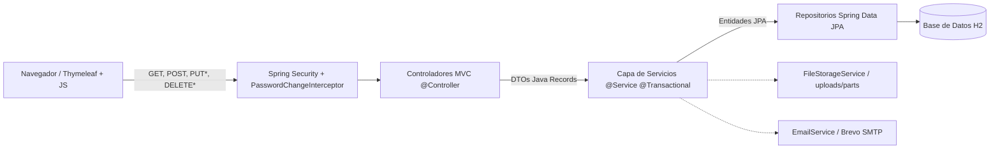
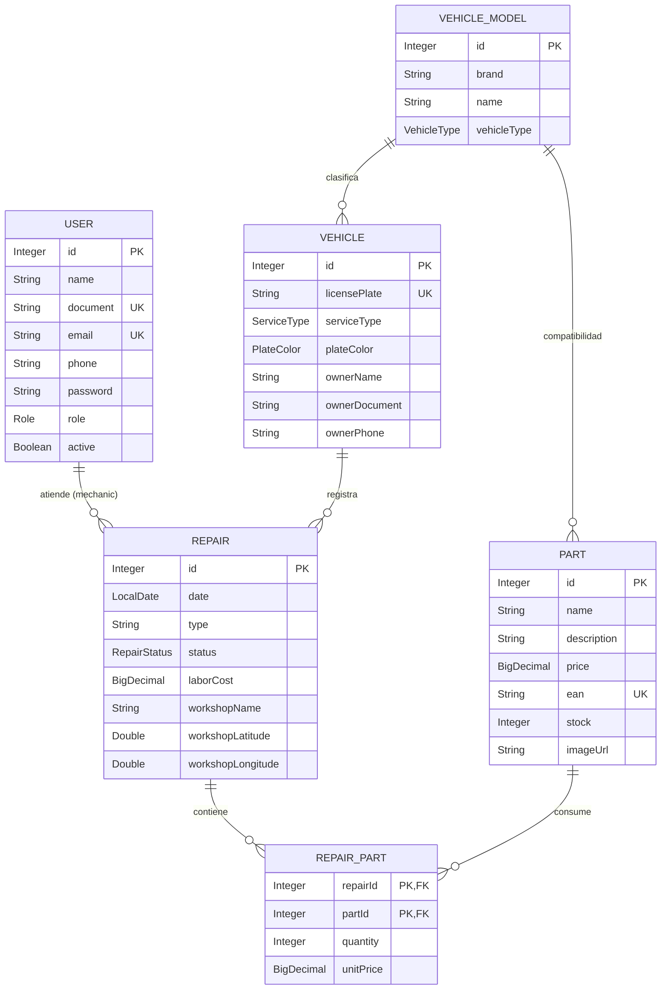

# Veloxa Service — Sistema de Gestión de Taller Automotriz


<<<<<<< HEAD
**Veloxa Service** es una aplicación web monolítica desarrollada con **Spring Boot** y **Thymeleaf** bajo una arquitectura MVC por capas y un sistema de diseño propio (**Neo-Garage OS**). Permite gestionar integralmente las operaciones de un taller automotriz: control de acceso por roles, catálogo de modelos, registro de vehículos con validación normativa de placas colombianas, inventario de repuestos con fotografías de referencia, órdenes de reparación transaccionales y geolocalización interactiva de talleres y puntos de compra.
=======
> **Estado de esta documentación (9 de noviembre de 2026):** actualizado a partir de la copia de `Integrador_5Semestre.zip` recibida en esta revisión. La existencia de clases y rutas demuestra implementación en el código, **no** que todas las funciones hayan superado pruebas. Ver [`docs/MATRIZ_REQUISITOS.md`](docs/MATRIZ_REQUISITOS.md) y [`docs/DIAGNOSTICO_PENDIENTES.md`](docs/DIAGNOSTICO_PENDIENTES.md).

## 1. Descripción y alcance

Aplicación web para administrar usuarios, modelos de vehículos, vehículos, repuestos, inventario y reparaciones de un taller automotriz. Las reparaciones registran fecha, vehículo, mecánico, estado, costo de mano de obra, **varios repuestos con sus cantidades y precios unitarios históricos**, y **un lugar donde se realizó la reparación** (nombre del taller, latitud y longitud). Un vehículo puede tener varias reparaciones y, por consiguiente, varias ubicaciones en su historial; cada reparación solo tiene un punto guardado.

El proyecto sigue la arquitectura de capas y MVC practicada en Bibliotech: vista Thymeleaf → Controller → Service → Repository → H2. Se trabaja con **seis tablas**, según la autorización actual del docente. Los distintos formatos de placa del proyecto se conservan.

## 2. Tecnologías

| Componente | Implementación encontrada |
|---|---|
| Lenguaje | Java 21 |
| Aplicación web | Spring Boot 3.2.5, Spring MVC  |
| Persistencia | Spring Data JPA / Hibernate |
| Base de datos | H2 **en archivo**, `./data/tallerdb` (persistente entre reinicios) |
| Vistas | Thymeleaf y water.css |
| Interacción | JavaScript separado en `static/js`; existe también JavaScript inline heredado en algunas plantillas |
| Mapa | Leaflet 1.9.4 + OpenStreetMap |
| Seguridad | Spring Security (sesiones y formulario de login), BCrypt, roles ADMIN y MECHANIC; **no usa JWT** |
| Recuperación de contraseña | Token temporal y Spring Mail/SMTP; entrega real condicionada a configuración SMTP |
| Construcción | Gradle Kotlin DSL (`build.gradle.kts`) |

## 3. Requisitos previos y ejecución local

- JDK 21 e IntelliJ IDEA (o terminal).
- Internet para descargar dependencias y cargar los mosaicos de OpenStreetMap/Leaflet.
- Desde la carpeta raíz ejecutar **Windows:** `gradlew.bat bootRun` o **macOS/Linux:** `./gradlew bootRun`. También se puede ejecutar `Application.java` desde IntelliJ.
- Abrir `http://localhost:8080/login`.
- Antes de actualizar clases JPA o iniciar pruebas destructivas, detener el servidor y **respaldar `data/`**, pues H2 almacena datos persistentes.

### Usuarios de demostración

`DataInitializer.java` crea tres cuentas **solo si no existen** y si `app.seed-test-users=true`:

| Cuenta de desarrollo | Rol |
|---|---|
| `admin@taller.test` | ADMIN |
| `mecanico1@taller.test` | MECHANIC |
| `mecanico2@taller.test` | MECHANIC |

Las contraseñas de prueba están definidas en `DataInitializer.java`; **no deben mantenerse para un despliegue público**. Como la base es persistente, una cuenta creada o modificada previamente no se reinicializa en cada ejecución.

### Consola H2

La aplicación configura la ruta `/h2-console`, restringida a ADMIN en `SecurityConfig.java`. JDBC: `jdbc:h2:file:./data/tallerdb;AUTO_SERVER=TRUE`, usuario `sa` y contraseña indicada en la configuración local (actualmente vacía en el archivo distribuido). La ruta de la base es relativa al directorio desde el que se inicia la aplicación.

## 4. Configuración relevante

Archivo: `src/main/resources/application.properties`. Variables y propiedades principales:

| Propiedad | Uso |
|---|---|
| `server.port=8080` | Puerto local |
| `spring.datasource.url=jdbc:h2:file:./data/tallerdb;AUTO_SERVER=TRUE` | Persistencia H2 |
| `spring.jpa.hibernate.ddl-auto=update` | Actualización automática del esquema para desarrollo; revisar antes de producción |
| `spring.h2.console.enabled=true` | Consola de H2, protegida para ADMIN |
| `spring.mvc.hiddenmethod.filter.enabled=true` | Formularios HTTP PUT/DELETE usando `_method` |
| `app.upload-dir=uploads/parts` | Almacenamiento local de imágenes |
| `spring.servlet.multipart.max-file-size=10MB` | Límite del servidor; `PartService` aplica la validación de **2 MB** |
| `app.base-url=http://localhost:8080` | Enlace de recuperación; debe cambiarse antes de desplegar públicamente |
| `app.recovery-token-minutes=30` | Duración configurada del enlace |
| `app.seed-test-users=true` | Usuarios de demostración; cambiar a `false` en producción |
| `MAIL_HOST`, `MAIL_USERNAME`, `MAIL_PASSWORD`, `MAIL_FROM` | Variables de entorno para SMTP |

**Correo:** `EmailService` intenta enviar por SMTP. Si no se configura o falla, escribe el enlace de recuperación en los registros del servidor para desarrollo: **no equivale a haber entregado un correo**. Evitar exponer tokens en logs públicos.

**Git:** `.gitignore` excluye `data/`, `uploads/`, `build/`, `.gradle/`, `.idea/` y `application-local.properties`. No publicar credenciales de SMTP ni respaldos H2.

## 5. Estructura de carpetas

```text
src/main/java/dev/tarazonarodriguezrojas/taller1/
├── Application.java
├── config/           DataInitializer, SecurityConfig, WebConfig, PasswordChangeInterceptor
├── controller/       Auth, User, VehicleModel, Vehicle, Part, Repair
├── service/          Auth, User, VehicleModel, Vehicle, Part, Repair,
│                     Email, FileStorage, PhoneValidation y auxiliares de seguridad
├── repository/       User, VehicleModel, Vehicle, Part, Repair, RepairPart
└── model/
    ├── constant/     Role, RepairStatus, VehicleType, ServiceType, PlateColor, PlateRules
    ├── dto/          UserDTO, VehicleModelDTO, VehicleDTO, PartDTO,
    │                 RepairDTO, RepairItemDTO, MechanicDTO, PlateModelDTO, LocationDTO
    └── entity/       User, VehicleModel, Vehicle, Part, Repair, RepairPart, RepairPartId
src/main/resources/
├── application.properties
├── templates/
│   ├── auth/         login, recuperación, cambio de contraseña, acceso denegado
│   ├── fragments/    nav.html, ui.html
│   ├── models/       list.html, form.html, detail.html
│   ├── vehicles/     list.html, form.html, detail.html, model-by-plate.html
│   ├── parts/        list.html, form.html, detail.html, compatible.html
│   ├── repairs/      list.html, form.html, detail.html, location.html, map.html
│   ├── users/        list.html, form.html, detail.html
│   └── index.html
└── static/
    ├── css/ui.css
    └── js/           ui.js, password-strength.js, phone-validation.js,
                     vehicles.js, repairs.js, repair-location.js,
                     repair-detail-map.js, repair-history-map.js
```

## 6. Modelo de datos: seis tablas

| Tabla | Entidad JPA | Datos y relaciones principales |
|---|---|---|
| `users` | `User` | Datos, correo, teléfono, contraseña cifrada, rol, estado activo, token de recuperación y `must_change_password`; un mecánico tiene muchas reparaciones |
| `model` | `VehicleModel` | Nombre, marca y `vehicle_type`; un modelo tiene vehículos y repuestos |
| `vehicle` | `Vehicle` | Placa, `service_type`, color de placa, propietario, modelo (`model_id`) |
| `part` | `Part` | Nombre, descripción, precio, EAN, stock, `image_url`, modelo compatible (`model_id`) |
| `repair` | `Repair` | Fecha, tipo, estado, costo de mano de obra, vehículo, mecánico, `workshop_name`, `workshop_latitude`, `workshop_longitude` |
| `repair_part` | `RepairPart` | Clave compuesta (`repair_id`, `part_id`), `quantity` y `unit_price` histórico |

**Nota de consistencia con el diagrama académico:** el diagrama proporcionado omite algunos atributos que sí existen en las entidades (por ejemplo `vehicle_type`, `service_type`, `must_change_password`, `quantity` y `unit_price`). No se han creado tablas adicionales. Antes de entregar el modelo definitivo se debe actualizar el diagrama para reflejar el esquema real; consultar `docs/DIAGNOSTICO_PENDIENTES.md`.

## 7. Funciones y permisos

| Actor | Acciones esperadas implementadas en código |
|---|---|
| ADMIN | Administración de usuarios, CRUD de modelos, vehículos, repuestos y reparaciones, imágenes y consultas |
| MECHANIC | Consulta de modelos y repuestos, registro/edición de vehículos, registro de reparaciones y edición de las propias; sin eliminar registros |

Spring Security define reglas de acceso en `SecurityConfig`. `RepairController` comprueba que el mecánico sea responsable antes de editar una reparación o su ubicación. **Estas restricciones deben validarse mediante pruebas de acceso directo**, no solo por botones ocultos.

### Teléfonos y correos

`PhoneValidation.java` comprueba formatos internacionales de **Colombia (+57), México (+52), EE. UU./Canadá (+1), España (+34), Chile (+56) y Perú (+51)**; el teléfono se guarda con el prefijo internacional en la misma columna. Los formularios usan `phone-validation.js`. `UserService` valida la sintaxis del correo y la unicidad. **No se verifica automáticamente si la línea o el buzón existen**.

### Inventario y reparaciones

- Una reparación admite **varios repuestos diferentes**, cada uno con cantidad mayor que cero.
- Se valida la compatibilidad por modelo y el stock disponible en el servidor.
- El stock se descuenta al guardar reparaciones no canceladas; se restituye o ajusta al cancelar, eliminar o editar la reparación.
- `unit_price` se guarda en `repair_part` como precio histórico; el costo total suma mano de obra y subtotales de los repuestos.
- El algoritmo actual usa lecturas y actualizaciones JPA convencionales; **no se ha demostrado protección ante concurrencia** (dos usuarios consumiendo el mismo último stock al mismo tiempo).

### Ubicaciones y mapa

- `repair` guarda una única ubicación (taller, latitud, longitud) por reparación.
- Al crear o editar la reparación se puede ingresar coordenadas, marcar en Leaflet o solicitar la ubicación del dispositivo (con autorización del navegador).
- El mapa `/repairs/map?plate=ABC-123` filtra por placa y muestra **todas las reparaciones con coordenadas** de esa placa; un mismo vehículo puede tener varios puntos históricos.
- Si dos reparaciones tienen las mismas coordenadas, `repair-history-map.js` separa visualmente los marcadores sin cambiar los datos guardados.
- `repairs/location.html` sigue existiendo como una ruta adicional de edición de ubicación, aunque la captura principal se hace ahora en `repairs/form.html`.

## 8. Rutas importantes

| Ruta | Función |
|---|---|
| `/login`, `/logout` | Inicio y cierre de sesión (logout por POST) |
| `/forgot-password`, `/reset-password`, `/change-password` | Recuperación y cambio de contraseña |
| `/users`, `/users/new`, `/users/{id}`, `/users/{id}/edit` | Usuarios (ADMIN) |
| `/models`, `/models/new`, `/models/{id}`, `/models/{id}/edit` | Modelos |
| `/vehicles`, `/vehicles/new`, `/vehicles/{id}`, `/vehicles/model-by-plate` | Vehículos y búsqueda por placa |
| `/parts`, `/parts/new`, `/parts/{id}`, `/parts/compatible` | Repuestos e identificación de compatibles |
| `/repairs`, `/repairs/new`, `/repairs/{id}`, `/repairs/{id}/edit` | Historial y formulario de reparaciones |
| `/repairs/{id}/location` | Edición independiente de la ubicación de una reparación |
| `/repairs/map`, `/repairs/map?plate=ABC-123` | Mapa de ubicaciones y filtro por placa |

Las operaciones de escritura utilizan POST, PUT y DELETE según el controlador y la configuración de `_method`.

## 9. Estado de los 30 requisitos

Se localizaron rutas/clases/vistas relacionadas con los **30 requisitos funcionales**, pero **no se ejecutó una prueba integral** en esta revisión. El detalle por RF, evidencia y pruebas pendientes está en [`docs/MATRIZ_REQUISITOS.md`](docs/MATRIZ_REQUISITOS.md).

**Verificaciones reportadas durante el trabajo:** registro y consulta de repuestos y reparaciones; el usuario informó que estas funciones operaban. Esas verificaciones manuales **no sustituyen** pruebas de regresión sobre este ZIP final ni justifican afirmar cobertura del 100 %.

## 10. Pruebas recomendadas

1. Ejecutar `gradlew.bat test` (Windows) o `./gradlew test`: el ZIP **no incluye clases en `src/test`**, por lo que es necesario crear pruebas automatizadas posteriormente.
2. Probar registro y edición de modelos, vehículos, usuarios y repuestos con datos válidos e inválidos.
3. Probar inicio/cierre de sesión, cuenta inactiva, permisos de mecánico y administrador y acceso por URL directa.
4. Probar reparación sin repuestos, con varios repuestos, cantidades inválidas, incompatibilidad y falta de stock.
5. Probar ediciones de cantidades, cancelaciones y eliminaciones y revisar stock antes y después.
6. Probar búsqueda por placa en mapa con dos reparaciones en lugares distintos y con coordenadas iguales.
7. Probar subida y reemplazo de imágenes permitidas y prohibidas.
8. Probar Toast, cambio de tema, persistencia del tema y recuperación real de contraseña mediante SMTP configurado.

Guía detallada: [`docs/PLAN_PRUEBAS.md`](docs/PLAN_PRUEBAS.md).

## 11. Riesgos y pendientes de revisión

- **Desfase documentación/diagrama:** actualizar el diagrama de seis tablas y los textos de la portada `index.html` que aún hablan de una tienda de repuestos y marcan todo como «Listo».
- **Correo:** confirmar la entrega SMTP real; sin SMTP el enlace se escribe en registros.
- **Seguridad:** eliminar usuarios de demostración en despliegues públicos, desactivar H2-console y dejar de exponer enlaces de recuperación en logs.
- **Inventario:** verificar concurrencia, transacciones, devoluciones y consistencia en cambios de estado.
- **Pruebas:** actualmente no hay clases de test en el ZIP.
- **Validaciones:** revisar EAN (se comprueban 13 dígitos, no dígito de control), existencia real de contactos y casos excepcionales de cada formulario.

Más detalle y prioridades: [`docs/DIAGNOSTICO_PENDIENTES.md`](docs/DIAGNOSTICO_PENDIENTES.md).
>>>>>>> a284b16 (tomcat)

---

## Tabla de Contenidos

1. [Características y Requisitos Funcionales](#1-características-y-requisitos-funcionales)
2. [Arquitectura del Sistema](#2-arquitectura-del-sistema)
3. [Stack Tecnológico](#3-stack-tecnológico)
4. [Seguridad y Control de Acceso (RBAC)](#4-seguridad-y-control-de-acceso-rbac)
5. [Reglas de Negocio Destacadas](#5-reglas-de-negocio-destacadas)
6. [Estructura del Proyecto](#6-estructura-del-proyecto)
7. [Requisitos Previos e Instalación](#7-requisitos-previos-e-instalación)
8. [Configuración y Variables de Entorno](#8-configuración-y-variables-de-entorno)
9. [Mapa de Rutas MVC](#9-mapa-de-rutas-mvc)
10. [Consola H2 y Usuarios de Prueba](#10-consola-h2-y-usuarios-de-prueba)
11. [Proyección a Producción (Arquitectura To-Be)](#11-proyección-a-producción-arquitectura-to-be)
12. [Autores](#12-autores)

---

## 1. Características y Requisitos Funcionales

### Seguridad y Gestión de Personal (`RF-01` a `RF-07`)
* **Autenticación Segura (`RF-01`, `RF-02`):** Inicio de sesión con correo electrónico (`email`) y contraseña cifrada con **BCrypt**, y cierre de sesión protegido vía `POST /logout` con token **CSRF**.
* **Recuperación y Cambio de Contraseña (`RF-03`, `RF-04`):** Solicitud de restablecimiento con respuesta neutra (anti-enumeración de correos), envío de enlace temporal con vigencia de 30 minutos mediante **Brevo SMTP**, y cambio obligatorio de contraseña temporal en el primer ingreso mediante `PasswordChangeInterceptor`.
* **Control de Roles (`RF-05`):** Restricción estricta de rutas y métodos HTTP para `ADMIN` y `MECHANIC`, con página personalizada de acceso denegado (`HTTP 403`).
* **Administración de Usuarios (`RF-06`, `RF-07`):** Alta de personal con generación de contraseña temporal de visualización única (*Flash Attribute*), edición con inmutabilidad de correo y documento, desactivación de cuentas para preservar trazabilidad y bloqueo de borrado si existen reparaciones asociadas.

### Modelos y Flota Vehicular (`RF-08` a `RF-15`, `RF-27`)
* **Catálogo de Modelos (`RF-08` a `RF-11`):** Registro y consulta de marcas, líneas y tipos de vehículo (`VehicleType`), determinando automáticamente el formato de placa correspondiente.
* **Registro y Control de Vehículos (`RF-12` a `RF-15`):** Normalización automática de placas, validación normativa colombiana según tipo y servicio, cálculo automático del color de placa con vista previa en vivo (`vehicles.js`), validación internacional de celulares y filtros de búsqueda por placa y propietario.
* **Consulta Rápida por Placa (`RF-27`):** Búsqueda instantánea de marca, modelo y clasificación de placa desde `/vehicles/model-by-plate`.

### Inventario de Repuestos (`RF-16` a `RF-20`, `RF-26`)
* **Gestión de Repuestos (`RF-16` a `RF-19`):** Control de nombre, descripción técnica, código **EAN**, precio unitario (`BigDecimal`), stock disponible y modelo compatible, con alertas visuales para stock bajo y existencias agotadas.
* **Fotografías de Referencia (`RF-20`):** Carga y reemplazo de imágenes almacenadas en disco bajo nombres **UUID** y expuestas mediante `/part-images/**`.
* **Compatibilidad por Modelo (`RF-26`):** Consulta directa de repuestos compatibles para cualquier modelo vehicular en `/parts/compatible`.

### Reparaciones, Geolocalización y Experiencia de Usuario (`RF-21` a `RF-25`, `RF-28` a `RF-30`)
* **Órdenes de Reparación Transaccionales (`RF-21` a `RF-25`):** Creación y actualización de órdenes con filtrado dinámico de repuestos compatibles según el vehículo seleccionado (`repairs.js`), descuento y ajuste transaccional de stock (`@Transactional`), cálculo exacto de costos con precio unitario histórico (`RepairItemDTO`) y autorización por registro (`assertCanModify`).
* **Geolocalización Interactiva (`RF-28`):** Registro de coordenadas de taller o punto de compra mediante mapa **Leaflet + OpenStreetMap** con captura de ubicación GPS del navegador (`repair-location.js`), mapa individual en el detalle de cada orden (`repair-detail-map.js`) y mapa histórico filtrable por placa con separación radial de marcadores superpuestos (`repair-history-map.js`).
* **Notificaciones Toast y Modo Claro/Oscuro (`RF-29`, `RF-30`):** Alertas no intrusivas sincronizadas con el servidor (`ui.js`) y cambio instantáneo entre tema oscuro (*Neo-Garage*) y tema claro persistido en `localStorage`.

---

## 2. Arquitectura del Sistema

La aplicación sigue el patrón **MVC por capas** con renderizado en servidor (**SSR**), desacoplando las entidades JPA de las vistas mediante **`record` de Java** (DTOs inmutables).

### Flujo de Peticiones



> \* Los métodos `PUT` y `DELETE` se envían desde formularios HTML estándar mediante `HiddenHttpMethodFilter` (`<input type="hidden" name="_method" value="put|delete">`).

### Modelo de Dominio (Entidades Principales)



---

## 3. Stack Tecnológico

| Capa | Tecnologías |
| :--- | :--- |
| **Backend** | Java (Records), Spring Boot 3, Spring Web MVC, Spring Security, Spring Data JPA, Hibernate |
| **Base de Datos** | H2 Database en modo archivo persistente (`./data/tallerdb`) con `AUTO_SERVER=TRUE` |
| **Frontend** | Thymeleaf, Thymeleaf Extras Spring Security, HTML5, CSS3 (Sistema de diseño *Neo-Garage*), JavaScript Vanilla |
| **Mapas y GPS** | Leaflet.js, OpenStreetMap Tiles, Geolocation API del navegador |
| **Correo Electrónico** | Spring Boot Mail + Brevo SMTP (`smtp-relay.brevo.com:587`, STARTTLS) |
| **Construcción** | Gradle Wrapper (Kotlin DSL — `build.gradle.kts`) |

---

## 4. Seguridad y Control de Acceso (RBAC)

Las reglas de autorización definidas en `SecurityConfig.java` se evalúan en orden estricto de prioridad:

| Recurso / Operación | `ADMIN` | `MECHANIC` | Público |
| :--- | :---: | :---: | :---: |
| `/login`, `/forgot-password`, `/reset-password`, `/access-denied`, `/error`, `/css/**`, `/js/**`, `/images/**` | ✅ | ✅ | ✅ |
| Gestión de usuarios (`/users/**`) y Consola H2 (`/h2-console/**`) | ✅ | ❌ `403` | ❌ |
| Crear, editar y eliminar **Modelos** (`/models/new`, `/*/edit`, `POST`/`PUT`/`DELETE`) | ✅ | ❌ `403` | ❌ |
| Crear, editar, eliminar **Repuestos** y subir imágenes (`/parts/new`, `/*/edit`, `POST`/`PUT`/`DELETE`) | ✅ | ❌ `403` | ❌ |
| Eliminar **Vehículos** y **Reparaciones** (`DELETE /vehicles/**`, `DELETE /repairs/**`) | ✅ | ❌ `403` | ❌ |
| Consultar modelos/repuestos, crear y editar **Vehículos** y **Reparaciones**, consultas y mapas | ✅ | ✅ | ❌ |

> **Regla adicional en reparaciones:** Aunque un mecánico puede editar reparaciones, `RepairService.assertCanModify(...)` verifica permisos a nivel de registro antes de permitir modificar una orden o su ubicación GPS.

---

## 5. Reglas de Negocio Destacadas

* **Placas Colombianas (`VehicleService` + `PlateRules`):**
  * Normaliza entradas sin guion o en minúsculas (`abc123` → `ABC-123`).
  * Valida coherencia entre tipo de vehículo del modelo, servicio y formato:
    * Carros, camionetas, camiones, buses y tractomulas: `ABC-123`
    * Motocicletas: `ABC-12` o `ABC-12A`
    * Remolques y semirremolques: `R-12345` / `S-12345` (siempre placa verde)
    * Vehículos diplomáticos: `CC-1234` o `CD-1234`
  * El color de placa se calcula automáticamente; únicamente los vehículos de servicio **Oficial** habilitan selección manual.
* **Validación Telefónica Internacional (`PhoneValidation`):** Exige formato internacional con signo `+` e indicativo para **Colombia** (`+57`), **México** (`+52`), **EE.UU./Canadá** (`+1`), **España** (`+34`), **Chile** (`+56`) y **Perú** (`+51`).
* **Integridad Financiera y de Inventario:**
  * Uso de `BigDecimal` para precios, mano de obra, subtotales y costo total, evitando errores de precisión de punto flotante.
  * El precio unitario de cada repuesto queda congelado en `RepairPart` al momento de la reparación para proteger el historial contable.
  * Bloqueo de eliminación de modelos, vehículos, repuestos o usuarios con registros dependientes (`IllegalStateException`).
* **Gestión de Archivos (`FileStorageService` + `WebConfig`):** Almacenamiento aislado en `uploads/parts` con renombrado UUID y protección contra *path traversal* al eliminar archivos.

---

## 6. Estructura del Proyecto

```text
Integrador_5Semestre/
├── build.gradle.kts
├── gradlew / gradlew.bat
├── data/                                   # Base de datos local H2 (ignorada en Git)
├── uploads/parts/                          # Imágenes de repuestos cargadas en disco
└── src/main/
    ├── java/dev/tarazonarodriguezrojas/taller1/
    │   ├── Application.java
    │   ├── config/
    │   │   ├── DataInitializer.java        # Carga inicial de usuarios de prueba
    │   │   ├── PasswordChangeInterceptor.java
    │   │   ├── SecurityConfig.java         # Reglas RBAC, BCrypt, CSRF y Login/Logout
    │   │   └── WebConfig.java              # Recurso /part-images/** e interceptor
    │   ├── controller/
    │   │   ├── AuthController.java
    │   │   ├── PartController.java
    │   │   ├── RepairController.java
    │   │   ├── UserController.java
    │   │   ├── VehicleController.java
    │   │   └── VehicleModelController.java
    │   ├── model/
    │   │   ├── constant/                   # Role, RepairStatus, VehicleType, ServiceType, PlateColor, PlateRules
    │   │   ├── dto/                        # Java Records (UserDTO, VehicleDTO, PartDTO, RepairDTO, LocationDTO, etc.)
    │   │   └── entity/                     # Entidades JPA (User, VehicleModel, Vehicle, Part, Repair, RepairPart)
    │   ├── repository/                     # Interfaces Spring Data JPA
    │   └── service/                        # Lógica de negocio, FileStorageService, PhoneValidation, EmailService
    └── resources/
        ├── application.properties
        ├── static/
        │   ├── css/theme.css               # Sistema de diseño Neo-Garage (Dark / Light)
        │   ├── images/                     # Marca (logo-veloxa.png), hero, banners y categorías
        │   └── js/
        │       ├── ui.js                   # Toasts Neo-Garage, tema y guard anti doble envío
        │       ├── vehicles.js             # Vista previa y reglas dinámicas de placas
        │       ├── repairs.js              # Ítems dinámicos y filtro de repuestos por modelo
        │       ├── repair-location.js      # Selector de ubicación Leaflet + GPS
        │       ├── repair-detail-map.js    # Mapa en detalle de orden
        │       ├── repair-history-map.js   # Mapa histórico con separación de pines superpuestos
        │       ├── phone-validation.js
        │       └── password-strength.js
        └── templates/
            ├── index.html
            ├── fragments/                  # head.html, nav.html, ui.html
            ├── auth/                       # login, forgot-password, reset-password, change-password, access-denied
            ├── models/                     # list, form, detail
            ├── vehicles/                   # list, form, detail, model-by-plate
            ├── parts/                      # list, form, detail, compatible
            ├── users/                      # list, form, detail
            └── repairs/                    # list, form, detail, location, map
```

---

## 7. Requisitos Previos e Instalación

### Prerrequisitos
* **JDK 17 o superior** instalado y configurado en `JAVA_HOME`.
* **Git** para clonar el repositorio.
* *(Opcional)* Cuenta SMTP en **Brevo** si se desea probar el envío real de correos de recuperación de contraseña.

### Pasos de Ejecución

1. **Clonar el repositorio:**
   ```bash
   git clone https://github.com/taritaaa/Integrador_5Semestre.git
   cd Integrador_5Semestre
   ```

2. **Ejecutar la aplicación con Gradle Wrapper:**
   * En **Windows (PowerShell / CMD):**
     ```powershell
     .\gradlew.bat bootRun
     ```
   * En **Linux / macOS:**
     ```bash
     ./gradlew bootRun
     ```

3. **Abrir en el navegador:**
   Accede a **`http://localhost:8080`** (el sistema redirigirá automáticamente a `/login`).

---

## 8. Configuración y Variables de Entorno

La configuración principal reside en `src/main/resources/application.properties`. Las credenciales SMTP se leen desde variables de entorno para no exponer secretos en el repositorio:

| Variable / Propiedad | Valor por Defecto | Descripción |
| :--- | :--- | :--- |
| `server.port` | `8080` | Puerto HTTP del servidor embebido |
| `spring.datasource.url` | `jdbc:h2:file:./data/tallerdb;AUTO_SERVER=TRUE` | Ruta persistente de la base de datos H2 |
| `spring.jpa.hibernate.ddl-auto` | `update` | Actualización automática del esquema JPA |
| `app.upload-dir` | `uploads/parts` | Carpeta física donde se guardan las fotos de repuestos |
| `app.base-url` | `http://localhost:8080` | URL base para generar enlaces de recuperación de clave |
| `app.recovery-token-minutes` | `30` | Tiempo de expiración de los tokens de recuperación |
| `app.seed-test-users` | `true` | Crea usuarios iniciales al arrancar (poner en `false` en producción) |
| `MAIL_HOST` | `smtp-relay.brevo.com` | Servidor SMTP para envío de correos |
| `MAIL_USERNAME` | *(vacío)* | Usuario SMTP de Brevo |
| `MAIL_PASSWORD` | *(vacío)* | Clave SMTP de Brevo |
| `MAIL_FROM` | `no-reply@taller.local` | Correo remitente para recuperación de contraseña |

---

## 9. Mapa de Rutas MVC

| Módulo | Ruta | Métodos | Descripción |
| :--- | :--- | :--- | :--- |
| **Acceso** | `/login`, `/logout` | `GET`, `POST` | Inicio y cierre de sesión |
| **Acceso** | `/forgot-password`, `/reset-password`, `/change-password` | `GET`, `POST` | Recuperación y cambio de contraseña |
| **Acceso** | `/access-denied` | `GET` | Pantalla de acceso denegado (`403`) |
| **Panel** | `/` | `GET` | Dashboard principal de Veloxa Service |
| **Usuarios** | `/users`, `/users/new`, `/users/{id}`, `/users/{id}/edit` | `GET`, `POST`, `PUT`, `DELETE` | CRUD de personal y roles *(solo `ADMIN`)* |
| **Modelos** | `/models`, `/models/new`, `/models/{id}`, `/models/{id}/edit` | `GET`, `POST`, `PUT`, `DELETE` | Catálogo de marcas y modelos |
| **Vehículos** | `/vehicles`, `/vehicles/new`, `/vehicles/{id}`, `/vehicles/{id}/edit` | `GET`, `POST`, `PUT`, `DELETE` | Gestión de vehículos y propietarios |
| **Vehículos** | `/vehicles/model-by-plate` | `GET` | Consulta de marca y modelo por placa |
| **Repuestos** | `/parts`, `/parts/new`, `/parts/{id}`, `/parts/{id}/edit` | `GET`, `POST`, `PUT`, `DELETE` | Gestión de inventario y existencias |
| **Repuestos** | `/parts/{id}/image`, `/parts/compatible` | `POST`, `GET` | Carga de imagen y búsqueda por modelo |
| **Reparaciones** | `/repairs`, `/repairs/new`, `/repairs/{id}`, `/repairs/{id}/edit` | `GET`, `POST`, `PUT`, `DELETE` | Órdenes de reparación y consumo de repuestos |
| **Mapas** | `/repairs/{id}/location`, `/repairs/map` | `GET`, `PUT` | Georreferenciación y mapa histórico |

---

## 10. Consola H2 y Usuarios de Prueba

* **Usuarios semilla:** Con `app.seed-test-users=true`, `DataInitializer` inicializa una cuenta de administrador (ej. `admin@taller.test`) y cuentas de mecánico para pruebas funcionales. Consulta `DataInitializer.java` para ver o ajustar las credenciales locales de desarrollo.
* **Consola Web de H2:** Disponible únicamente para usuarios con rol `ADMIN` en `http://localhost:8080/h2-console`:
  * **JDBC URL:** `jdbc:h2:file:./data/tallerdb;AUTO_SERVER=TRUE`
  * **User Name:** `sa`
  * **Password:** *(vacío)*

---

## 11. Proyección a Producción (Arquitectura To-Be)

Para desplegar **Veloxa Service** en un entorno productivo real, la arquitectura contempla las siguientes transiciones sin alterar la lógica de negocio:

1. **Base de Datos:** Migrar de H2 embebida a **PostgreSQL** gestionando migraciones versionadas con **Flyway**.
2. **Almacenamiento de Archivos:** Sustituir `FileStorageService` en disco local por almacenamiento de objetos en la nube (**Amazon S3** o **Google Cloud Storage**).
3. **Endurecimiento de Seguridad:** Establecer `app.seed-test-users=false`, deshabilitar `/h2-console`, configurar HTTPS detrás de un *reverse proxy* (Nginx/Caddy) e inyectar secretos mediante un gestor seguro.
4. **Despliegue:** Empaquetar el ejecutable en un contenedor **Docker** multi-etapa con monitoreo mediante Spring Boot Actuator.

---

## 12. Autores

Desarrollado como **Proyecto Integrador — 5.° Semestre**:

* **Equipo Tarazona · Rodríguez · Rojas** (`dev.tarazonarodriguezrojas.taller1`)